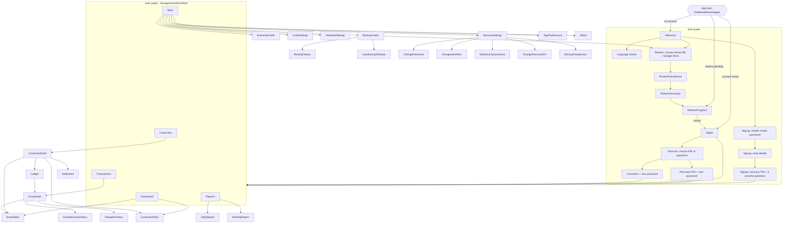

# Contract: Navigation Graph and Screens

Type-safe Navigation Compose routes (`@Serializable`). Arguments are ids only, never whole objects.
The lock screen is **not** a route: it is an overlay drawn above the `NavHost` whenever
`SessionManager.state == Locked`, so the back stack and `SavedStateHandle`-backed form state
survive locking (US1-8).

## Routes

| Route | Args | Screen / notes |
|-------|------|----------------|
| `Welcome` | — | create account / restore / language |
| `SignupAccount`, `SignupShop`, `SignupQuestions` | — | one shared `SignupViewModel` scoped to the signup sub-graph; the account is created only at the last step (atomic) |
| `SignIn` | — | identifier + password, biometric button, lockout countdown |
| `ForgotPassword`, `RecoverWithPin`, `RecoverWithQuestions` | — | US11; each recovery screen takes the secret and the new password together, so verification and reset are one atomic step |
| `RestoreSource`, `RestorePassphrase`, `RestoreSummary`, `RestoreProgress` | `source: DEVICE\|DRIVE`, `driveFileId?` | US9; reachable from Welcome and BackupCenter |
| `Dashboard` | — | top-level |
| `Customers` | `filter?` | top-level; `ListDetailPaneScaffold` with `CustomerDetail` on expanded width |
| `CustomerDetail` | `customerId` | balance header, quick actions, recent entries |
| `CustomerEditor` | `customerId?`, `returnToPicker: Boolean` | add/edit; inline creation from entry editor returns the new id via `SavedStateHandle` result |
| `Ledger` | `customerId` | full ledger with running balance |
| `EntryEditor` | `type`, `customerId?`, `editRootId?` | one editor for all 4 types; type switchable when editing (FR-033b) |
| `EntryDetail` | `rootId` | detail, receipt, edit, void, revisions |
| `EntryRevisionHistory` | `rootId` | audit trail |
| `ReceiptPreview` | `rootId` | PDF preview + share |
| `History` | — | top-level; filter sheet, chips, export |
| `Statement` | `customerId`, `from?`, `to?` | preview + export + WhatsApp |
| `Reports`, `DailyReport(date)`, `MonthlyReport(yearMonth)` | | |
| `More` and settings routes | — | see diagram |

## Top-level destinations and adaptive layout

| Width class | Container | Extras |
|-------------|-----------|--------|
| Compact (< 600 dp) | bottom navigation bar (5 items) | FAB "New entry" on Dashboard/History/Customers opens a type chooser (Sell / Buy / Receive / Pay) |
| Medium (600–840 dp) | navigation rail | FAB in rail |
| Expanded (≥ 840 dp) | permanent navigation drawer | list–detail two-pane for Customers and History |

Back behaviour: from any top-level destination except Dashboard, back returns to Dashboard; back on
Dashboard exits. Editors with unsaved changes ask "Discard changes?" before leaving.

Deep links: none exported (no exported components except the launcher activity). Notification
taps for backup failures open `BackupCenter` through an explicit `PendingIntent` to `MainActivity`.
