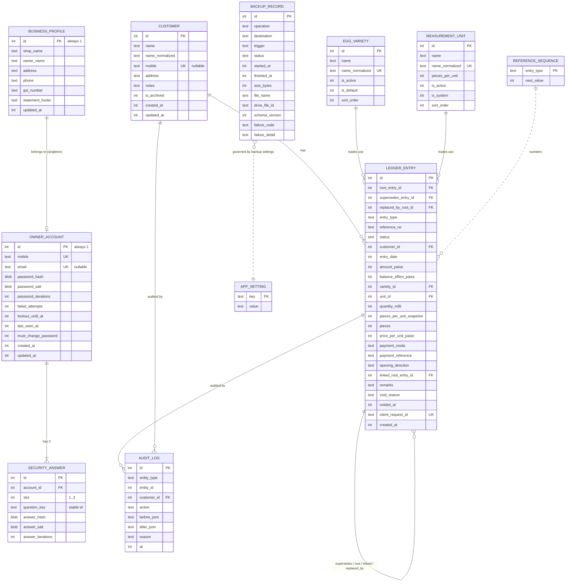

# Data Model: Egg Business Manager

**Feature**: [spec.md](./spec.md) | **Plan**: [plan.md](./plan.md) | **Research**: [research.md](./research.md)

The database is a single encrypted Room database, `egg_business.db` (SQLCipher, R7), at **schema
version 1** for the first release. Room exports every schema version to `data/schemas/` and those
files are committed (Constitution III).

## Conventions

| Concern | Rule |
|---------|------|
| Money | `INTEGER` paise (`Long`). Columns end in `_paise`. Never `REAL`. |
| Quantity | `INTEGER` thousandths of a unit (`quantity_milli`). |
| Business date | `INTEGER` epoch day (`LocalDate.toEpochDay()`) in the device's local calendar at entry time. Columns end in `_date`. |
| Timestamp | `INTEGER` epoch milliseconds UTC. Columns end in `_at`. |
| Enums | `TEXT` holding stable English constant names (never localized, never renamed once released). |
| Booleans | `INTEGER` 0/1. |
| Search keys | `*_normalized` columns: trimmed, whitespace-collapsed, NFKC, lowercase (`Locale.ROOT`). |
| Primary keys | `INTEGER PRIMARY KEY AUTOINCREMENT` (ids are never reused). |
| Foreign keys | Enforced (`PRAGMA foreign_keys=ON`). `ON DELETE RESTRICT` everywhere; nothing cascades. |

## ER Diagram



## Table Definitions

### `owner_account` (singleton, id = 1)

| Column | Type | Null | Constraint / Notes |
|--------|------|------|--------------------|
| id | INTEGER | no | PK, CHECK (id = 1) |
| mobile | TEXT | no | UNIQUE; normalized 10 digits `[6-9]\d{9}` |
| email | TEXT | yes | UNIQUE; lowercase |
| password_hash | BLOB | no | PBKDF2-HMAC-SHA256, 32 bytes |
| password_salt | BLOB | no | 16 random bytes |
| password_iterations | INTEGER | no | ≥ 600000 |
| recovery_pin_hash / recovery_pin_salt / recovery_pin_iterations | BLOB/BLOB/INTEGER | no | 6-digit recovery PIN, PBKDF2 (FR-012) |
| failed_attempts | INTEGER | no | default 0; shared by sign-in, unlock, password change, recovery (FR-006) |
| lockout_until_at | INTEGER | yes | epoch ms |
| last_seen_at | INTEGER | no | guards against the clock moving backwards |
| must_change_password | INTEGER | no | 1 after restore-with-passphrase reset (US9-9) |
| created_at, updated_at | INTEGER | no | |

### `security_answer`

| Column | Type | Null | Constraint / Notes |
|--------|------|------|--------------------|
| id | INTEGER | no | PK |
| account_id | INTEGER | no | FK → owner_account.id |
| slot | INTEGER | no | CHECK (slot IN (1,2,3)); UNIQUE (account_id, slot) |
| question_key | TEXT | no | stable key from the predefined list (≥ 10); UNIQUE (account_id, question_key) |
| answer_hash / answer_salt / answer_iterations | BLOB/BLOB/INTEGER | no | normalized answer, PBKDF2 |

### `business_profile` (singleton, id = 1)

shop_name TEXT NOT NULL (2–80), owner_name TEXT NOT NULL (2–80), address TEXT (≤ 250),
city TEXT NOT NULL (2–60), state_code TEXT NOT NULL (stable `IndianState` constant name),
pin_code TEXT NOT NULL (6 digits, first 1–9), phone TEXT,
gst_number TEXT (≤ 15), statement_footer TEXT (≤ 200), updated_at INTEGER NOT NULL.

### `customer`

| Column | Type | Null | Constraint / Notes |
|--------|------|------|--------------------|
| id | INTEGER | no | PK |
| name | TEXT | no | 2–80 chars, as entered |
| name_normalized | TEXT | no | INDEX; used by `LIKE '%q%'` search |
| mobile | TEXT | yes | UNIQUE (across active + archived, FR-016); INDEX |
| address | TEXT | yes | ≤ 250 |
| notes | TEXT | yes | ≤ 500 |
| is_archived | INTEGER | no | default 0; INDEX (is_archived, name_normalized) |
| created_at, updated_at | INTEGER | no | |

The opening balance is **not** a column; it is a `ledger_entry` of type `OPENING_BALANCE` (R4). Hard
delete is allowed only when no `ledger_entry` references the customer (FK RESTRICT enforces this).

### `measurement_unit`

| Column | Type | Null | Constraint / Notes |
|--------|------|------|--------------------|
| id | INTEGER | no | PK |
| name | TEXT | no | 1–20 chars |
| name_normalized | TEXT | no | UNIQUE |
| pieces_per_unit | INTEGER | no | CHECK (1–10000) |
| is_active | INTEGER | no | default 1 |
| is_system | INTEGER | no | 1 only for Piece (cannot be edited or deactivated) |
| sort_order | INTEGER | no | |

Seed data (pre-populated callback on create): Piece 1 (system), Dozen 12, Tray 30, Box 210.

### `egg_variety`

id PK, name TEXT NOT NULL (1–30), name_normalized TEXT UNIQUE, is_active INTEGER, is_default INTEGER,
sort_order INTEGER. Exactly one row has `is_default = 1` and at least one row is active — enforced in
`CatalogRepository` within a transaction. Seed: White (default), Brown, Country (Desi).

### `ledger_entry` — the central financial table

| Column | Type | Null | Constraint / Notes |
|--------|------|------|--------------------|
| id | INTEGER | no | PK (one row per revision) |
| root_entry_id | INTEGER | no | FK → ledger_entry.id; equals `id` for the first revision; shared by all revisions of one logical entry |
| supersedes_entry_id | INTEGER | yes | FK → the previous revision |
| replaced_by_root_id | INTEGER | yes | set on the final SUPERSEDED row when the type changed (→ "Changed to <ref>") |
| entry_type | TEXT | no | `OPENING_BALANCE` \| `SELL` \| `BUY` \| `PAYMENT_RECEIVED` \| `PAYMENT_MADE` |
| reference_no | TEXT | no | `OB-`/`S-`/`B-`/`RP-`/`PC-` + 6 digits; identical across revisions of one root |
| status | TEXT | no | `ACTIVE` \| `SUPERSEDED` \| `VOIDED` |
| customer_id | INTEGER | no | FK → customer.id |
| entry_date | INTEGER | no | epoch day; CHECK (≥ 10957 i.e. 2000-01-01) |
| amount_paise | INTEGER | no | CHECK (amount_paise BETWEEN 0 AND 99999999999) (= ₹99,99,99,999.99); > 0 except OPENING_BALANCE may be 0 |
| balance_effect_paise | INTEGER | no | signed; computed only by `BalanceEffect.of()` |
| variety_id | INTEGER | yes | FK → egg_variety.id; NOT NULL for SELL/BUY |
| unit_id | INTEGER | yes | FK → measurement_unit.id; NOT NULL for SELL/BUY |
| quantity_milli | INTEGER | yes | > 0 for trades |
| pieces_per_unit_snapshot | INTEGER | yes | unit size at save time (FR-022) |
| pieces | INTEGER | yes | quantity_milli × snapshot / 1000, exact integer, 1–10,000,000 |
| price_per_unit_paise | INTEGER | yes | 1–100000000 for trades |
| payment_mode | TEXT | yes | `CASH` \| `UPI` \| `BANK_TRANSFER` \| `CHEQUE` \| `OTHER`; NOT NULL for payments |
| payment_reference | TEXT | yes | ≤ 50 |
| opening_direction | TEXT | yes | `CUSTOMER_OWES` \| `SHOP_OWES`; only for OPENING_BALANCE |
| linked_root_entry_id | INTEGER | yes | trade ↔ on-the-spot payment link (both directions stored) |
| remarks | TEXT | yes | ≤ 500 |
| void_reason | TEXT | yes | |
| voided_at | INTEGER | yes | |
| client_request_id | TEXT | yes | UNIQUE; UUID from the editor; prevents duplicate saves (R6) |
| created_at | INTEGER | no | time recorded; ledger tie-breaker (BR-011) |

**Type-specific CHECK constraints** (in the table definition):

- `entry_type IN ('SELL','BUY')` ⇒ variety_id, unit_id, quantity_milli, pieces_per_unit_snapshot,
  pieces, price_per_unit_paise NOT NULL; payment_mode NULL.
- `entry_type IN ('PAYMENT_RECEIVED','PAYMENT_MADE')` ⇒ payment_mode NOT NULL; trade columns NULL.
- `entry_type = 'OPENING_BALANCE'` ⇒ opening_direction NOT NULL; trade and payment columns NULL.
- `balance_effect_paise` sign rules: SELL ⇒ `= amount`; BUY ⇒ `= -amount`; PAYMENT_RECEIVED ⇒
  `= -amount`; PAYMENT_MADE ⇒ `= amount`; OPENING_BALANCE ⇒ `= ±amount` by direction. This is a
  defence-in-depth duplicate of the domain rule.

**Indexes**:

| Index | Purpose |
|-------|---------|
| (customer_id, status, entry_date, created_at) | balance, ledger, running balance, statements |
| (status, entry_date, entry_type) | dashboard, daily/monthly reports |
| (root_entry_id) | revision history |
| (reference_no) | search by reference |
| (linked_root_entry_id) | linked payment lookup |
| (customer_id, entry_type, variety_id, unit_id, status, entry_date) | last-price pre-fill (FR-024) |
| UNIQUE (client_request_id) | idempotent saves |
| Partial UNIQUE (root_entry_id) WHERE status = 'ACTIVE' | at most one active revision per logical entry (created by raw SQL in the `onCreate` callback and in migrations, because Room `@Index` has no WHERE clause) |

### `audit_log`

| Column | Type | Notes |
|--------|------|-------|
| id | INTEGER PK | |
| entity_type | TEXT | `LEDGER_ENTRY` \| `CUSTOMER` \| `UNIT` \| `VARIETY` \| `ACCOUNT` \| `PROFILE` |
| entity_id | INTEGER | root_entry_id for entries; customer id, etc. |
| customer_id | INTEGER NULL | FK → customer `ON DELETE SET NULL`; customer-related actions (both customers for a customer change get rows). SET NULL rather than RESTRICT so an unused customer stays deletable; the deleted customer's id remains in `entity_id` and a `DELETE` row is written |
| action | TEXT | `CREATE` \| `DELETE` \| `EDIT` \| `VOID` \| `TYPE_CHANGE` \| `CUSTOMER_CHANGE` \| `OPENING_CHANGE` \| `ARCHIVE` \| `UNARCHIVE` \| `UNIT_RESIZE` \| `RENAME` \| `PASSWORD_CHANGE` \| `RECOVERY` |
| before_json / after_json | TEXT NULL | kotlinx.serialization snapshots of business fields only (never secrets) |
| reason | TEXT NULL | ≤ 200 |
| at | INTEGER | |

Index (entity_type, entity_id, at), (customer_id, at).

### `reference_sequence`

`entry_type TEXT PK`, `next_value INTEGER NOT NULL`. Seeded with 1 for each of the 5 types.
Incremented only inside the entry-save transaction.

### `app_setting` (key–value; backed up)

| Key | Value | Default |
|-----|-------|---------|
| `language` | `en` \| `hi` | device language if Hindi, else `en` |
| `theme` | `SYSTEM` \| `LIGHT` \| `DARK` | SYSTEM |
| `auto_lock_minutes` | 1 \| 5 \| 15 \| 30 | 5 |
| `default_sell_unit_id`, `default_buy_unit_id` | unit id | Tray |
| `display_unit_id` | unit id | Tray |
| `auto_backup_enabled` | bool | false |
| `auto_backup_frequency` | `DAILY` \| `WEEKLY` | DAILY |
| `auto_backup_window` | `NIGHT` \| `MORNING` \| `AFTERNOON` \| `EVENING` | NIGHT |
| `auto_backup_wifi_only`, `auto_backup_charging_only` | bool | true, false |

Typed access is through `SettingsRepository`; unknown keys are ignored (forward-compatible).

### `backup_record`

| Column | Type | Notes |
|--------|------|-------|
| id | INTEGER PK | |
| operation | TEXT | `BACKUP` \| `RESTORE` |
| destination | TEXT | `DEVICE` \| `GOOGLE_DRIVE` |
| trigger | TEXT | `MANUAL` \| `AUTOMATIC` |
| status | TEXT | `IN_PROGRESS` \| `SUCCESS` \| `FAILED` |
| started_at / finished_at | INTEGER / INTEGER NULL | |
| size_bytes | INTEGER NULL | |
| file_name / drive_file_id | TEXT NULL | |
| schema_version | INTEGER | |
| failure_code | TEXT NULL | `NO_NETWORK` \| `AUTH_REQUIRED` \| `DRIVE_FULL` \| `LOCATION_UNAVAILABLE` \| `LOW_STORAGE` \| `WRONG_PASSPHRASE` \| `CORRUPT` \| `NEWER_VERSION` \| `NOT_A_BACKUP` \| `INTERRUPTED` \| `UNKNOWN` |
| failure_detail | TEXT NULL | technical detail, never secrets |

Index (started_at DESC). Rows are device-operational: during restore the device's current rows are
carried into the restored database (R10).

## Device-only state (not in the database, never backed up)

Stored in `noBackupFilesDir` via DataStore (Proto/Preferences), with key material wrapped by the
Android Keystore:

| Item | Purpose |
|------|---------|
| `db_key_wrapped` + IV | SQLCipher key wrapped by Keystore key `ebm_db_wrap` (AES-GCM, no user auth) |
| `backup_kek_wrapped` + IV, `backup_salt`, `backup_kdf_iterations` | passphrase-derived KEK for background backups (R9) |
| `biometric_enabled`, `biometric_token_wrapped` | biometric unlock (Keystore key `ebm_bio`, auth-bound, invalidated by enrollment) |
| `drive_account_email` | linked Google account (display and authorization hint) |
| `backup_status` | last success time, consecutive failures/misses, next scheduled time |
| `restore/state.json` | restore state machine (R10) |

## Derived read models (queries, not tables)

| Read model | Definition |
|------------|------------|
| CustomerBalance | `SELECT customer_id, SUM(balance_effect_paise) FROM ledger_entry WHERE status='ACTIVE' GROUP BY customer_id` |
| LedgerLine | active entries of a customer ordered `entry_date, created_at, id` with `SUM(balance_effect_paise) OVER (ORDER BY entry_date, created_at, id)` running balance |
| Brought-forward | `SUM(balance_effect_paise)` for active entries with `entry_date < :start` |
| Totals by type | `SUM(amount_paise), SUM(pieces), COUNT(*)` grouped by entry_type (and variety, payment_mode for reports) over a date range |
| Receivable / Payable | `SUM(CASE WHEN bal>0 THEN bal END)`, `SUM(CASE WHEN bal<0 THEN -bal END)` over CustomerBalance (BR-007) |
| Last activity | `MAX(entry_date)` of active entries per customer |
| Last price | most recent active trade for (customer, type, variety, unit) |

The domain `LedgerCalculator` recomputes the same figures in Kotlin from entry lists. Tests assert
SQL == Kotlin for generated data sets (SC-003).

## State Transitions

### Ledger entry (one logical entry = one `root_entry_id`)

```text
            create
   (none) ─────────► ACTIVE ──edit────► SUPERSEDED  (+ new ACTIVE revision, same root & reference)
                       │  └──type change► SUPERSEDED  (+ new root, new reference; replaced_by_root_id)
                       └──void─────────► VOIDED     (terminal; no edit, no un-void)
   SUPERSEDED and VOIDED rows are terminal and are never deleted (FR-035).
```

A customer change is an edit (same root, new revision with a different `customer_id`). Both
customers' balances change in the same transaction (FR-033a).

### Customer

```text
   ACTIVE ⇄ ARCHIVED (archive / un-archive)      ACTIVE ─delete─► (removed)  only if no ledger rows
```

### Backup record

```text
   IN_PROGRESS ─► SUCCESS | FAILED      (rows left IN_PROGRESS after a process death become FAILED/INTERRUPTED at next start)
```

### Restore (device-only state machine, R10)

```text
   IDLE ─stage+validate─► STAGED ─restart─► SWAPPING ─► VERIFYING ─► COMMITTED ─first sign-in─► IDLE
                                              └──────────┴─ failure/crash ─► ROLLED_BACK ─► IDLE
```

## Validation (where enforced)

Validation rules from the spec's Validation Rules table are implemented once in `:domain`
validators (`EntryValidator`, `CustomerValidator`, `AccountValidator`, `CatalogValidator`) and
called by use cases. Presentation calls the same validators for inline messages. The database
CHECK and UNIQUE constraints are a second line of defence, not the primary mechanism.

## Migration Policy

- `exportSchema = true`; the Room Gradle plugin's `schemaDirectory("$projectDir/schemas")`.
- Every version bump adds `MIGRATION_n_(n+1)` (or a verified `@AutoMigration` with spec) in
  `data/db/migration/`, plus a `MigrationTestHelper` test, plus a test chaining from v1 to latest
  with seeded data and asserting balances are unchanged.
- `fallbackToDestructiveMigration*` is never called (lint check in CI script: grep fails the build).
- The partial unique index and the CHECK constraints are re-created by migrations that rebuild
  `ledger_entry`.
- The pre-migration snapshot is taken by `DatabaseBootstrapper` (R10).
- Future extensibility (spec: varieties must stay extensible): a later multi-line bill can add a
  `ledger_entry_line` child table (variety, unit, quantity, price, line total). The existing single-line
  trades migrate to one line each with no data loss, and `amount_paise` stays the bill total, so
  balance queries are unchanged.
