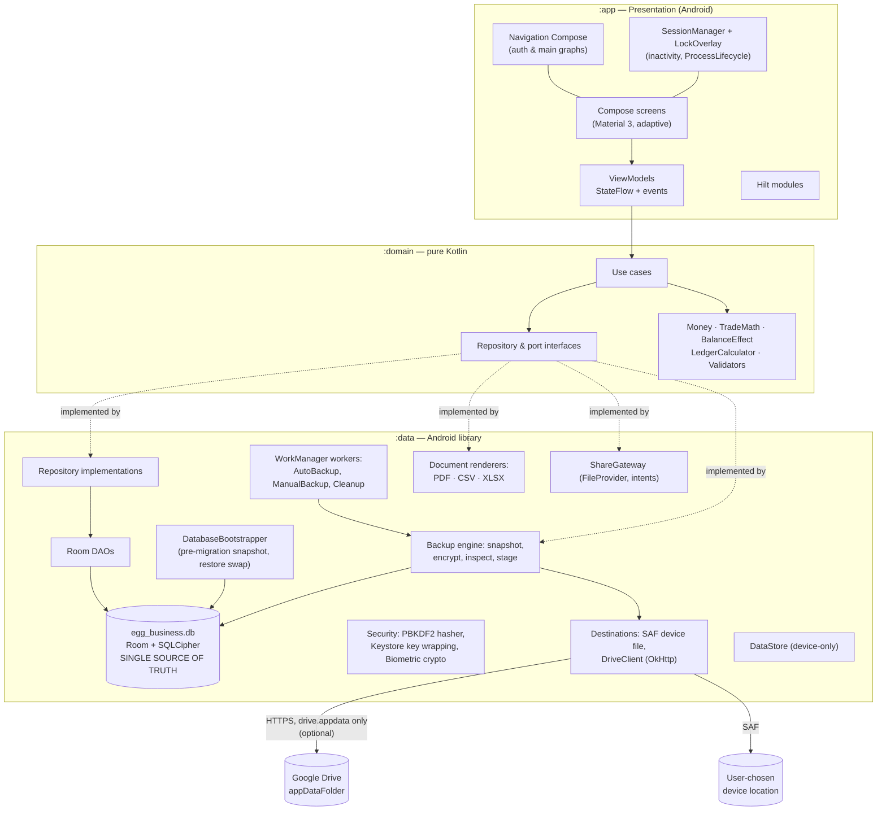
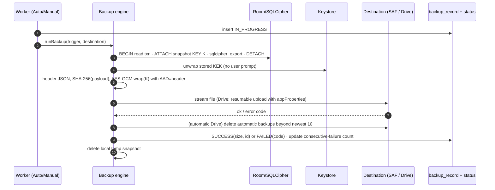
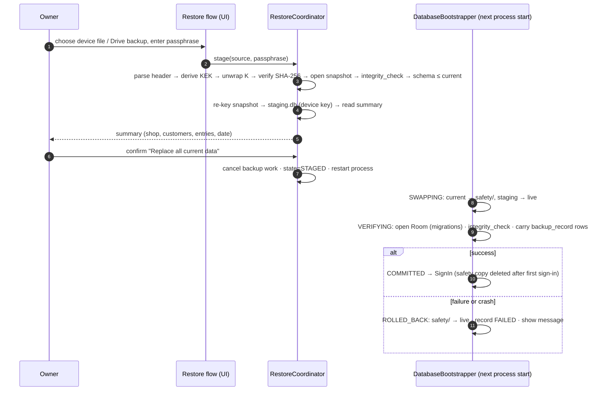

# Implementation Plan: Egg Business Manager

**Branch**: `001-egg-business-manager` | **Date**: 2026-11-07 | **Spec**: [spec.md](./spec.md)

**Input**: Feature specification from `/specs/001-egg-business-manager/spec.md`

**Companion artifacts**: [research.md](./research.md) (decisions R1–R18) ·
[data-model.md](./data-model.md) (ER diagram, tables) · [contracts/](./contracts/) (domain
interfaces, backup format, exports/sharing, navigation) · [quickstart.md](./quickstart.md)
(build and validation).

## Summary

A native, single-owner, fully offline Android app (Kotlin, Jetpack Compose, Material 3) for an egg
trading shop. It records SELL/BUY trades (per egg variety, in configurable units) and payments in
both directions, and keeps an exact customer-wise ledger where
`Balance = Opening + Sales − Purchases − Received + Paid`.

The technical approach:
- **Layers**: MVVM + Clean Architecture in three production modules (`:app`, `:domain`, `:data`).
- **Storage**: one encrypted Room database (SQLCipher) as the single source of truth.
- **Ledger**: one append-only `ledger_entry` table with a signed `balance_effect_paise` computed in
  one domain function, with integer-paise arithmetic everywhere.
- **Backup**: a physical encrypted snapshot, sent to a SAF location or to Google Drive's
  `appDataFolder`, scheduled by WorkManager; restore uses a crash-safe process-restart swap.
- **Security**: PBKDF2-hashed credentials, Keystore-wrapped keys, and an optional biometric unlock.

## Technical Context

**Language/Version**: Kotlin 2.x (K2), JVM target 17; Gradle Kotlin DSL + version catalog (R1)

**Primary Dependencies**: Jetpack Compose (BOM), Material 3 + `material3-adaptive` /
`adaptive-navigation-suite`, Navigation Compose (type-safe), Lifecycle/ViewModel, Hilt (+ hilt-work,
hilt-navigation-compose), Room (KSP) + SQLCipher for Android, DataStore, WorkManager, AndroidX
Biometric, AppCompat (per-app language), Paging 3 (history lists), Google Identity Services `AuthorizationClient`, OkHttp,
kotlinx.serialization, kotlinx.coroutines/Flow. Versions are pinned at setup to the latest stable.

**Storage**: Room/SQLCipher `egg_business.db` (business data and backed-up settings); DataStore and
Keystore-wrapped blobs in `noBackupFilesDir` (device-only keys and state); `cacheDir/exports` for
temporary documents; SAF and Drive `appDataFolder` for backups.

**Testing**: JUnit 4, kotlinx-coroutines-test, Turbine, Truth, Kotest-property, Room
`MigrationTestHelper`, OkHttp MockWebServer, WorkManager `work-testing`, Compose UI test + Hilt
testing, Kover coverage, Macrobenchmark for SC-005 (R17).

**Target Platform**: Android phones, tablets and foldables; `minSdk 31`; `compileSdk/targetSdk` =
latest stable (expected 37, ≥ 36); arm64-v8a, armeabi-v7a, x86_64; 16 KB page-size compatible.

**Project Type**: Mobile app (single Android application, no backend).

**Performance Goals**: search results < 1 s, dashboard < 2 s, monthly report < 5 s with 2,000
customers / 100,000 entries on a mid-range phone (SC-005); 60 fps scrolling with paged lists; cold
start < 2 s (excluding the PBKDF2 sign-in ~0.5–1 s).

**Constraints**: 100% offline except Drive backup; no backend/Firebase/analytics; money exact to the
paisa; atomic writes; zero data loss across upgrades and restores; no paid services; APK sideload
distribution.

**Scale/Scope**: 1 user per device; ~2,000 customers, ~100,000 entries over years; ~40 screens;
2 languages; backups of a few MB to ~50 MB.

## Constitution Check

*GATE: Must pass before Phase 0 research. Re-checked after Phase 1 design (below).*

| # | Principle | How this plan complies | Pre | Post |
|---|-----------|------------------------|-----|------|
| I | Offline-first, local-only | Room is the only data store; no backend, Firebase or analytics; network used only by `DriveClient`; INTERNET permission justified solely by Drive (§ Permissions) | ✅ | ✅ |
| II | Financial accuracy and ledger integrity | `Long` paise, one rounding point (`TradeMath`), one sign rule (`BalanceEffect`), no stored balance, append-only revisions + audit log, every multi-row write in `TransactionRunner`, CHECK constraints, SQL-vs-Kotlin recompute tests (R3–R6) | ✅ | ✅ |
| III | Safe schema evolution and upgrade continuity | exported schemas, explicit migrations, `MigrationTestHelper` chain tests, no destructive fallback (scripted check), pre-migration snapshot, downgrade guard, fixed applicationId and signing key, monotonic versionCode (R10, R18) | ✅ | ✅ |
| IV | Security by default | PBKDF2 credentials, progressive lockout, auto-lock, Keystore-wrapped SQLCipher key, biometric `BIOMETRIC_STRONG` with enrollment invalidation, `allowBackup=false` + `dataExtractionRules` excluding all, no secrets in logs, R8, no exported components except the launcher (R7, R8). **DB encryption decision documented: YES (SQLCipher)** | ✅ | ✅ |
| V | Optional, encrypted Drive backup | `drive.appdata` only, app fully usable without Google, AES-256-GCM with passphrase-derived KEK (cross-device restore), header metadata + SHA-256, safety snapshot + rollback, WorkManager unique periodic work with constraints and backoff, history and status, local SAF alternative (R9–R12) | ✅ | ✅ |
| VI | Native Android, Compose, Material 3 | 100% Compose UI, Material 3 theme with light/dark + dynamic color; the only non-Compose rendering is `PdfDocument` Canvas drawing, which has no Compose equivalent | ✅ | ✅ |
| VII | MVVM + Clean Architecture | `:domain` pure JVM module; ViewModels expose `StateFlow<UiState>` and call use cases only; Hilt; injected dispatchers; `SavedStateHandle` for drafts | ✅ | ✅ |
| VIII | Test discipline | unit (domain 100% money/ledger branches), integration (DAO, migrations, backup round trip incl. wrong passphrase/corrupt/newer), UI (auth/lock, sale, payment, ledger, backup/restore), deterministic fakes (§ Testing Strategy) | ✅ | ✅ |
| IX | Ease of use | dashboard quick actions, last-price pre-fill, inline customer creation, confirmations for destructive actions, 48 dp targets, font scaling, English/Hindi resources, locale-aware formatting | ✅ | ✅ |
| X | Cost control and dependencies | every library is free and open source or free from Google (Play services auth only for the optional Drive feature); no ads/analytics/tracking SDKs; Google Cloud project at zero cost; in-house XLSX/PDF writers instead of heavy libraries | ✅ | ✅ |

**Gate result**: PASS. No violations, so Complexity Tracking is empty.

**Items for owner confirmation (not violations)**: the final `applicationId` (proposed
`com.eggbusinessmanager.app`, R18) — it can never change after the first APK is shared — and the
creation and safe storage of the release keystore.

## System Architecture



**Layer rules**

- Dependencies point inward: `:app → :domain ← :data`; `:app` depends on `:data` only for Hilt wiring.
  `:domain` has no Android, Room, Hilt or OkHttp imports (enforced by its Gradle module type).
- Data flow: Room `Flow` → repository (maps entities ↔ domain models) → use case → ViewModel
  `StateFlow` → Compose. Writes go Compose event → ViewModel → use case (validation + business
  rules) → repository inside `TransactionRunner`.
- **Single source of truth**: screens never hold authoritative copies of data. After any write,
  every screen updates from Room's invalidation-driven Flows (FR-032: identical balances everywhere).
- Threading: injected `@IoDispatcher` (DB, files, network) and `@DefaultDispatcher` (PBKDF2,
  rendering). The main thread is never blocked.
- Errors: use cases return `DomainResult`; ViewModels map `DomainError` to localized messages;
  unexpected exceptions are caught at the ViewModel boundary and show "Something went wrong. Your
  saved data is safe." No crash reporting SDK. A local, rotating, PII-free diagnostic log in
  `noBackupFilesDir` exists in debug builds only.

## Centralized Ledger and Financial Integrity

- **One table, one sign rule**: every money movement is a `ledger_entry` (R4). `BalanceEffect.of()`
  is the only code that decides sign; repositories persist its result. CHECK constraints mirror the
  rule as defence in depth.
- **No stored balances**: balances, running balances, brought-forward amounts, dues and report
  totals are SQL aggregates over `status = 'ACTIVE'` rows (data-model § Derived read models).
  `LedgerCalculator` recomputes the same in Kotlin for tests.
- **Exact arithmetic**: `Money`/`QuantityMilli` value classes; `TradeMath.lineTotal` is the only
  rounding (HALF_UP to paise); `*Exact` operations throw on overflow, mapped to a validation error.
- **Atomic multi-row writes**: trade + on-the-spot payment; edit (supersede + insert + audit);
  type change (supersede + new root + new reference + linked-payment conversion/void + audit);
  customer change (both customers' audit rows); customer creation with opening balance; unit
  resize audit. Each runs in one `withTransaction` block, together with the reference-sequence
  increment and idempotency key.
- **Append-only history**: no DAO method deletes a `ledger_entry` (FR-035). Void is a status change.

## Repository Design

Full interface list and signatures: [contracts/domain-interfaces.md](./contracts/domain-interfaces.md).

| Repository / port | Implementation in `:data` | Backing |
|-------------------|---------------------------|---------|
| AccountRepository | `RoomAccountRepository` | `owner_account`, `security_answer` |
| BusinessProfileRepository | `RoomBusinessProfileRepository` | `business_profile` |
| CustomerRepository | `RoomCustomerRepository` (search = normalized `LIKE`, balances via aggregate join) | `customer` + `ledger_entry` |
| LedgerRepository | `RoomLedgerRepository` — the only writer of `ledger_entry` and `reference_sequence` | `ledger_entry`, `audit_log`, `reference_sequence` |
| CatalogRepository | `RoomCatalogRepository` | `measurement_unit`, `egg_variety` |
| ReportRepository | `RoomReportRepository` (read-only aggregate DAOs; paged history via Paging 3 `PagingSource`) | views over `ledger_entry` |
| SettingsRepository | `RoomSettingsRepository` (+ mirrors language to AppCompat locales) | `app_setting` |
| AuditRepository | `RoomAuditRepository` (called inside other repositories' transactions) | `audit_log` |
| BackupRepository | `BackupRepositoryImpl` | `backup_record` + DataStore `backup_status` |
| BackupCrypto | `SnapshotBackupCrypto` | SQLCipher export + JCA + Keystore |
| BackupDestination | `SafDeviceDestination`, `DriveAppDataDestination` | SAF / Drive REST |
| RestoreCoordinator | `ProcessRestartRestoreCoordinator` + `DatabaseBootstrapper` | files + state machine |
| DocumentRenderer | `PdfRenderer`, `CsvRenderer`, `XlsxRenderer` | `PdfDocument`, streams |
| ShareGateway | `IntentShareGateway` | FileProvider, intents |
| SecretHasher | `Pbkdf2SecretHasher` | JCA |
| SessionManager | `InMemorySessionManager` | process memory + DataStore flags |

Repositories map Room entities to domain models in `data/mapper/`. No Room entity crosses into
`:domain` or `:app`.

## Use Cases

The complete catalogue, mapped to spec requirements, is in
[contracts/domain-interfaces.md § Use cases](./contracts/domain-interfaces.md#use-cases-by-feature).
Authoring rules:

1. One public `invoke`.
2. Validate first with the shared domain validators.
3. Business rules live in domain code; repository code only persists.
4. Every write is a single transaction.
5. Return `DomainResult`, never throw for expected failures.
6. Inject `Clock` for "today" (future-date rule, dashboard periods, midnight rollover).

## Navigation Architecture

The full graph, routes and adaptive behaviour are in [contracts/navigation.md](./contracts/navigation.md).

- Start destination is decided after `DatabaseBootstrapper` completes: pending restore →
  `RestoreProgress`; no account → `Welcome`; account → `SignIn`.
- `NavigationSuiteScaffold` gives top-level Dashboard / Customers / Transactions / Reports / More,
  shown as a bottom bar, a rail or a drawer by window size; `ListDetailPaneScaffold` handles
  Customers and History on wide screens.
- One `EntryEditor` route serves all four entry types, including editing and type switching.
- The lock overlay sits above the `NavHost` (not a route), so state survives locking.
- No exported deep links; notification `PendingIntent`s target `MainActivity` explicitly.

## Backup Architecture

Format details: [contracts/backup-format.md](./contracts/backup-format.md).





- **Keys**: the backup passphrase is set on first backup and is separate from the login password.
  The KEK is derived once and stored wrapped by Keystore so scheduled backups need no input; the
  KEK can be re-derived from the passphrase on any device for restore.
- **Scheduling** (R12): unique periodic work `drive-auto-backup`; Wi-Fi/charging/battery/storage
  constraints; exponential backoff; foreground `dataSync` notification for long uploads; restore
  holds a mutex shared with the backup workers.
- **Status and history**: `backup_record` rows for every attempt; DataStore status (last success,
  next run, consecutive failures/misses). Notification at 3 consecutive failed/missed periods. The
  dashboard reminder appears after 7 days without success.
- **Isolation**: a failed backup never writes to the live DB (read transaction only) and deletes its
  temp files.
- **Upgrades**: older backups restore through normal Room migrations because the payload is a
  physical DB at its own `user_version`; newer ones are rejected.

## Security Architecture

**Threat model**

| Threat | Mitigations |
|--------|-------------|
| Someone picks up an unlocked/idle phone | auto-lock (1–30 min, default 5), lock on background timeout, recents preview hidden |
| Someone knows the phone PIN but not the app password | separate app password; lockout; biometric limited to `BIOMETRIC_STRONG` |
| Password guessing / security-answer guessing | PBKDF2 600k; progressive lockout persisted across restarts and clock changes; generic error messages |
| Device storage extracted (root, forensic) | SQLCipher DB with Keystore-wrapped key; secrets only as salted hashes; `allowBackup=false`; `dataExtractionRules` exclude everything |
| Backup file leaked (Drive account compromise, shared file) | AES-256-GCM with passphrase KEK; no business data in plaintext header; PBKDF2 slows offline guessing |
| Tampered or corrupt backup | GCM-authenticated header, SHA-256 payload, SQLCipher page HMAC, integrity_check before swap |
| Network attacker | HTTPS only (`cleartextTrafficPermitted=false`), Google endpoints only, platform trust store |
| Malicious apps on device | no exported components except the launcher; FileProvider grants per share with read-only temporary permission; no world-readable files |
| Data leaking through logs | release build strips `Log` calls (R8 rules); domain errors carry codes, not data; audit JSON excludes secrets |

**Key hierarchy**

```text
Android Keystore (hardware-backed where available)
├── ebm_db_wrap   AES-256-GCM, no user auth ──wraps──► SQLCipher DB key (32 B random)
├── ebm_kek_wrap  AES-256-GCM, no user auth ──wraps──► Backup KEK (= PBKDF2(passphrase, salt))
└── ebm_bio       AES-256-GCM, user auth required, invalidated on biometric enrollment
                  └── decrypts biometric unlock token (proves a BiometricPrompt success)
Per backup: random K (32 B) encrypts the payload; K is wrapped by the KEK (AES-GCM, AAD = header)
Secrets at rest: login password, 3 security answers → PBKDF2-HMAC-SHA256 hashes (+ salt, iterations)
```

**Authentication flows**: sign-up (atomic account + profile + answers); sign-in (mobile or email,
generic failure); biometric unlock (CryptoObject); change password and identifiers (current
password required); recovery (all 3 answers → new password → review questions); restore reset
(passphrase proven → `must_change_password`). Failed-attempt counting is shared across sign-in,
password change and recovery (FR-006).

## Testing Strategy

| Level | Location | What is covered | Gate |
|-------|----------|-----------------|------|
| Unit — domain | `domain/src/test` | `Money`, `TradeMath` (rounding, whole-piece rule, overflow), `BalanceEffect`, `LedgerCalculator` (running, brought-forward, receivable/payable), all validators (every row of the spec's Validation Rules table), every use case with fake repositories + fixed `Clock` | domain ≥ 90% lines; `money`/`ledger` packages 100% branches |
| Property-based | `domain/src/test` | for random entry sequences: balance = Σ effects = formula; edits/voids preserve invariants; type change moves balance by the expected amount; line totals sum exactly | 1,000 cases per property |
| Unit — presentation | `app/src/test` | ViewModels: state, validation messages, double-tap guard, lock/unlock retention via `SavedStateHandle`, advance/edit previews | all ViewModels |
| Integration — data | `data/src/androidTest` | DAOs on real SQLCipher (temp DB); SQL aggregates == `LedgerCalculator` on generated data; transaction atomicity (inject failure mid-transaction ⇒ nothing persisted); idempotent `client_request_id`; partial unique index; CHECK constraints | required for merge |
| Migrations | `data/src/androidTest` | `MigrationTestHelper` (SQLCipher factory) for each step plus v1→latest with seeded data and balance equality; downgrade guard | required for any schema change |
| Backup/restore | `data/src/androidTest` | round trip byte-for-byte equality of tables; wrong passphrase; truncated/corrupt; foreign file; newer schema; passphrase change; bootstrapper crash injection at each state; carry-over of `backup_record` | required |
| Drive client | `data/src/test` | MockWebServer: resumable upload, resume after interruption, list/parse appProperties, retention deletes only automatic beyond 10, error-code mapping (401, 403 quota, 429, 5xx) | required |
| Workers | `data/src/androidTest` | `work-testing`: constraints, backoff, unique work replacement, failure counting, notification at 3 | required |
| Documents | `data/src/androidTest` | PDF page count/text extraction smoke test; CSV exact bytes for a fixture (BOM, escaping); XLSX opens as ZIP with valid XML and numeric cells; Hindi strings present | required |
| UI | `app/src/androidTest` | Compose + Hilt with fakes: signup → dashboard; sign-in + lockout; lock overlay keeps form; record sale (with on-the-spot payment); record payment (advance notice); customer ledger; edit/void; statement share intent; backup → restore flow; Hindi locale smoke run; large font scale | critical flows (Constitution VIII) |
| Performance | `benchmark/` (Macrobenchmark, optional module) | SC-005 timings with seeded 2,000/100,000 data set | before release |
| Release checks | manual checklist (quickstart 16) | APK upgrade N-1 → N with data, old backup restore, signing check (`apksigner verify`) | every release |

Determinism: injected `Clock`, `IdGenerator`, test dispatchers; no real network (MockWebServer and
a fake `BackupDestination`); temporary databases deleted after each test.

## Android Permission Requirements

| Permission | Type | Why | When requested |
|------------|------|-----|----------------|
| `android.permission.INTERNET` | normal | Google authorization and Drive REST (backup/restore only — Constitution I) | install time |
| `android.permission.ACCESS_NETWORK_STATE` | normal | WorkManager network constraints; offline message before a manual Drive backup | install time |
| `android.permission.POST_NOTIFICATIONS` | **runtime (API 33+)** | backup failure / missed-backup notifications, and the progress notification for long backups | asked when the owner enables automatic backup; the app works if denied (status still shown in-app) |
| `android.permission.USE_BIOMETRIC` | normal | BiometricPrompt | install time; feature opt-in in Settings |
| `android.permission.FOREGROUND_SERVICE` + `FOREGROUND_SERVICE_DATA_SYNC` | normal | WorkManager `setForeground` for long backup uploads (API 34+ requires the type) | install time |
| `android.permission.RECEIVE_BOOT_COMPLETED`, `WAKE_LOCK` | normal | merged automatically by WorkManager to keep schedules after reboot | install time |

**Not requested** (by design): storage permissions (SAF and app-private storage need none), contacts,
phone/SMS, camera, location, accounts (`GET_ACCOUNTS` — AuthorizationClient handles account choice),
`SCHEDULE_EXACT_ALARM`, `QUERY_ALL_PACKAGES` (targeted `<queries>` for WhatsApp instead).

**Manifest hardening**: `android:allowBackup="false"`, `android:dataExtractionRules` and
`android:fullBackupContent` excluding all domains; `usesCleartextTraffic="false"` +
`networkSecurityConfig` (no user CAs in release); only `MainActivity` exported (launcher);
`FileProvider` `exported="false"` with `grantUriPermissions`; WorkManager's default initializer
replaced by the Hilt `Configuration.Provider`; `<queries>` for `com.whatsapp`, `com.whatsapp.w4b`
and `ACTION_SEND`; `localeConfig` for English/Hindi.

## APK Distribution and Upgrade Safety

- **Signed release APK** (v2 + v3 signatures), R8 enabled, `debuggable=false`.
- `versionCode = major×10000 + minor×100 + patch`, always increasing.
- `applicationId` is fixed forever, with one release keystore (stored off-repo plus an offline
  backup copy).
- **On every start**, the `DatabaseBootstrapper`:
  1. Completes or rolls back a pending restore.
  2. Takes a pre-migration snapshot when `user_version` < current.
  3. Refuses a newer `user_version` (downgrade).
  4. Then opens Room.
- **Install over an older version**: WorkManager schedules, DataStore and Keystore entries persist
  across `adb install -r` / package-installer updates, and nothing is keyed to `versionCode`.
- **Release checklist** (Constitution quality gates): tests green; schema JSON committed; migration
  tests; upgrade-install test with realistic data; restore of the previous release's backup;
  release notes listing schema and backup-format changes.

## Project Structure

### Documentation (this feature)

```text
specs/001-egg-business-manager/
├── spec.md
├── plan.md              # this file
├── research.md          # Phase 0 decisions R1–R18
├── data-model.md        # ER diagram, tables, states, migration policy
├── quickstart.md        # build + 18 validation scenarios
├── contracts/
│   ├── domain-interfaces.md
│   ├── backup-format.md
│   ├── export-and-share.md
│   └── navigation.md
├── checklists/requirements.md
└── tasks.md             # Phase 2 (/speckit-tasks) — not created by /speckit-plan
```

### Source Code (repository root)

```text
EggBusinessManager/
├── settings.gradle.kts
├── build.gradle.kts
├── gradle/libs.versions.toml
├── scripts/check-no-destructive-migration.ps1
├── app/                                   # :app — presentation + DI (Android application)
│   ├── src/main/AndroidManifest.xml
│   ├── src/main/res/{values,values-hi,xml}/    # strings, locales_config, file_paths, data_extraction_rules, network_security_config
│   ├── src/main/java/com/eggbusinessmanager/app/
│   │   ├── EggBusinessApplication.kt      # Hilt, WorkManager Configuration.Provider, bootstrap
│   │   ├── MainActivity.kt                # single activity, recents protection
│   │   ├── di/                            # AppModule, DispatcherModule, UseCaseModule
│   │   ├── navigation/                    # routes, AuthGraph, MainGraph, AppNavHost
│   │   ├── session/                       # LockOverlay, InactivityTracker
│   │   ├── ui/theme/ · ui/components/ · ui/format/   # Material 3 theme, shared composables, MoneyFormatter
│   │   └── feature/
│   │       ├── auth/ (welcome, signup, signin, recovery)
│   │       ├── dashboard/
│   │       ├── customers/ (list, detail, editor)
│   │       ├── entries/ (editor, detail, revisions)
│   │       ├── ledger/
│   │       ├── history/
│   │       ├── statements/
│   │       ├── reports/
│   │       ├── backup/ (center, history, auto settings, passphrase, restore flow)
│   │       └── settings/ (profile, units, varieties, security, preferences, about)
│   ├── src/test/                          # ViewModel tests
│   └── src/androidTest/                   # Compose UI tests (Hilt)
├── domain/                                # :domain — pure Kotlin JVM library
│   └── src/main/kotlin/com/eggbusinessmanager/domain/
│       ├── model/ · money/ · ledger/ · validation/ · error/
│       ├── repository/                    # interfaces + ports
│       └── usecase/{auth,customer,entry,ledger,history,dashboard,document,backup,settings}/
│   └── src/test/
├── data/                                  # :data — Android library
│   ├── schemas/                           # exported Room schemas (committed)
│   └── src/main/java/com/eggbusinessmanager/data/
│       ├── db/ (EggBusinessDatabase, entity/, dao/, migration/, converter/, DatabaseBootstrapper, SeedCallback)
│       ├── repository/ · mapper/
│       ├── security/ (Pbkdf2SecretHasher, KeystoreKeyWrapper, BiometricCryptoProvider, InMemorySessionManager)
│       ├── backup/ (format/, crypto/, SnapshotBackupCrypto, RestoreCoordinator, destination/{saf,drive}/, worker/)
│       ├── document/ (model/, pdf/, csv/, xlsx/)
│       ├── share/ · settings/ (DataStore) · di/
│   ├── src/test/                          # Drive client (MockWebServer), CSV/XLSX pure tests
│   └── src/androidTest/                   # DAO, migration, backup, worker, document tests
├── core-testing/                          # fakes, builders, fixed Clock, seed generators
└── benchmark/                             # optional Macrobenchmark module (SC-005)
```

**Structure Decision**: one Android application with three production modules (`:app`, `:domain`,
`:data`) plus `:core-testing` and an optional `:benchmark` (R2). There is no backend or API project
(Constitution I). The package root `com.eggbusinessmanager.app` follows the proposed applicationId,
which the owner must confirm before the first release.

## Complexity Tracking

No constitution violations, so nothing needs justification here.
